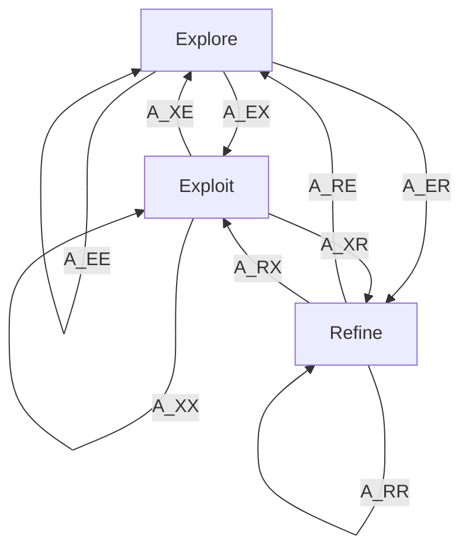

At each completed evaluation, the prequential GP residual updates the posterior state belief.
The transition matrix expresses persistence and switching probabilities; the diagram is not a
deterministic stage sequence.
